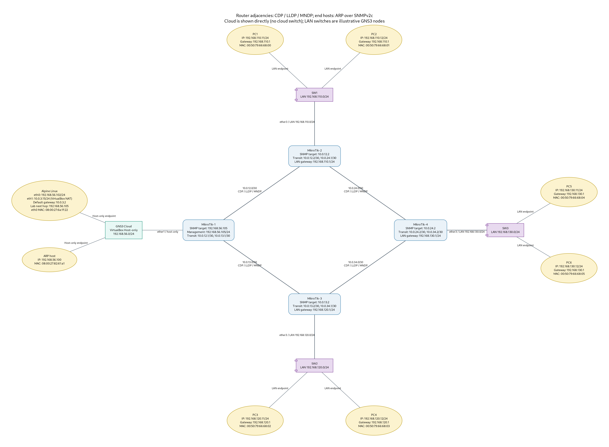
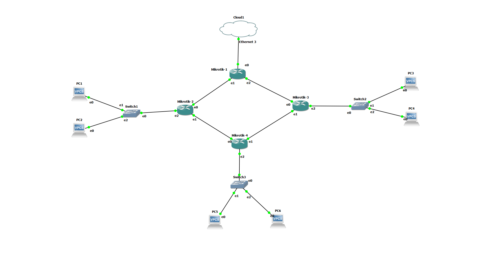

# Automated Network Topology Discovery and Documentation Engine

A graduation project that collects network information from four MikroTik CHR routers and produces a documented topology diagram. The lab uses SNMPv2c to read router identity, interface names, LLDP data, MikroTik neighbor data, and ARP tables. A companion SSH collection step reads RouterOS neighbor details so the diagram can label router adjacencies learned through CDP, LLDP, and MNDP.

## Project artifacts

- `src/snmp_check_routers.py` — checks SNMP reachability for the four configured routers.
- `src/snmp_discovery.py` — collects system information and SNMP tables and writes `discovery.json`.
- `src/add_neighbor_protocols.py` — collects RouterOS `/ip/neighbor` details over SSH and updates `discovery.json`.
- `src/render_corrected_topology.py` — renders the topology as `topology_corrected.png` using Graphviz.
- `discovery.json` — a captured discovery result from the lab.
- `configs/` — RouterOS text exports for the four MikroTik routers.
- `docs/topology_corrected.png` — the rendered topology snapshot.



## Lab topology

The lab has four MikroTik CHR routers in a diamond:

| Link | Subnet | Router addresses |
|---|---|---|
| MikroTik-1 — MikroTik-2 | `10.0.12.0/30` | `10.0.12.1` — `10.0.12.2` |
| MikroTik-1 — MikroTik-3 | `10.0.13.0/30` | `10.0.13.1` — `10.0.13.2` |
| MikroTik-2 — MikroTik-4 | `10.0.24.0/30` | `10.0.24.1` — `10.0.24.2` |
| MikroTik-3 — MikroTik-4 | `10.0.34.0/30` | `10.0.34.1` — `10.0.34.2` |

The LANs are `192.168.110.0/24` behind MikroTik-2, `192.168.120.0/24` behind MikroTik-3, and `192.168.130.0/24` behind MikroTik-4. The management segment is `192.168.56.0/24`; Alpine Linux uses `192.168.56.102` and MikroTik-1 uses `192.168.56.105` on that segment.

## Discovery method and scope

- SNMPv2c reads router system information and the interface, LLDP, MikroTik neighbor, and ARP tables.
- The SSH step reads RouterOS neighbor details, including the `discovered-by` protocols (CDP, LLDP, and MNDP).
- ARP entries are used to identify hosts visible to the routers; ARP tables do not guarantee that every powered-on endpoint appears until it has communicated on the LAN.
- GNS3 Cloud and Ethernet switch symbols in the diagram represent the lab wiring. The built-in GNS3 Ethernet switches are manually represented; this project does not claim to discover their port tables through SNMP.
- Router adjacency is derived from the collected neighbor data. The diagram includes known LAN gateways and endpoint labels from the lab design.

## Requirements

- Python 3.14.10 (the version used in the lab)
- PySNMP 7.1.22
- Python `graphviz` package and the Graphviz system executable (`dot`/`neato`)
- OpenSSH client
- Four reachable MikroTik CHR routers with RouterOS neighbor discovery enabled
- SNMPv2c read-only access configured on each router and permitted from the Alpine management address

The scripts are configured for the lab addresses above. If your addressing or SNMP community differs, update the constants in `src/snmp_discovery.py` and `src/snmp_check_routers.py`. Keep the community read-only and restrict its allowed source address to the management host.

## Run from the repository root

Create and activate a virtual environment, then install the Python packages:

```sh
python3 -m venv .venv
. .venv/bin/activate
python -m pip install -r requirements.txt
```

Run the collection and rendering steps in order:

```sh
python src/snmp_check_routers.py
python src/snmp_discovery.py
python src/add_neighbor_protocols.py
python src/render_corrected_topology.py
```

The SSH collection may prompt for the RouterOS `admin` password for each router and for host-key confirmation on first connection. The final command writes `topology_corrected.png` in the current repository directory. To refresh the image shown in this README, copy the new image to `docs/topology_corrected.png`.

## Configuration exports

The `configs/MikroTik-1.rsc` through `configs/MikroTik-4.rsc` files are text exports captured from the lab routers. They document the lab configuration; they are not binary RouterOS backups. Review addressing and interface names before importing an export into any router.

## Reproducibility note

This repository contains the source, captured discovery data, router text exports, and rendered diagram. The original GNS3 project depends on the author's local Windows adapters and QEMU images, so it is not included as a portable, ready-to-run GNS3 project. Recreating the live lab requires equivalent GNS3 nodes, RouterOS images, host-only connectivity, and the addressing described above.

## Actual GNS3 lab screenshot

The screenshot below shows the GNS3 workspace used for this project: four MikroTik CHR routers, three LAN Ethernet switches, six VPCS endpoints, and the Cloud connection to MikroTik-1. This is the actual simulator layout used for the captured discovery data. The GNS3 adapter labels `e0`, `e1`, and `e2` correspond to RouterOS `ether1`, `ether2`, and `ether3` in this lab.



The GNS3 project itself is not included because it depends on local Windows host-only adapters and QEMU images. The generated discovery diagram is provided separately above as `docs/topology_corrected.png`.
